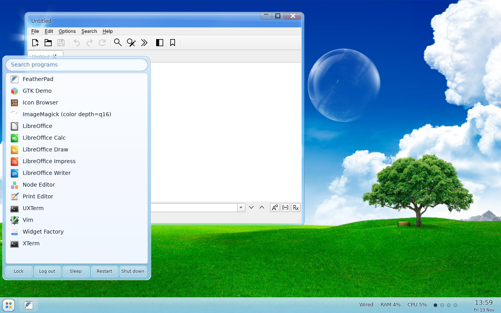
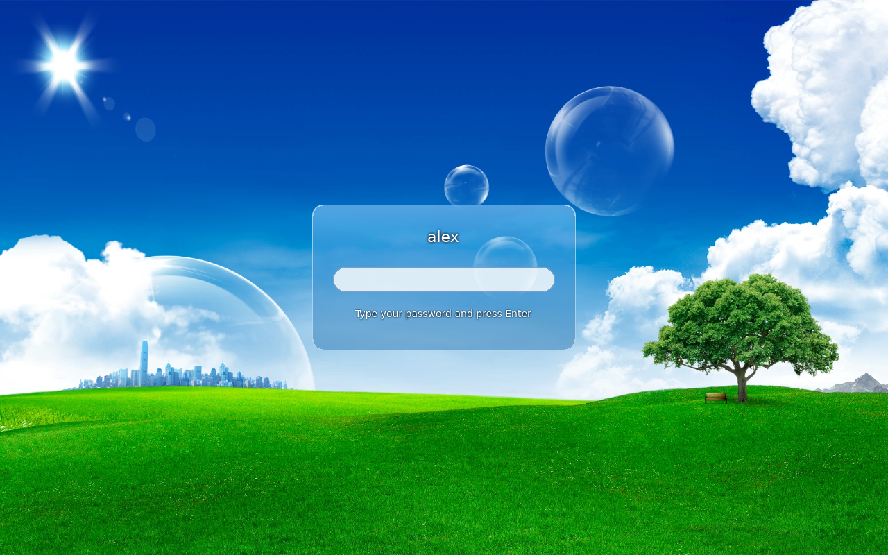
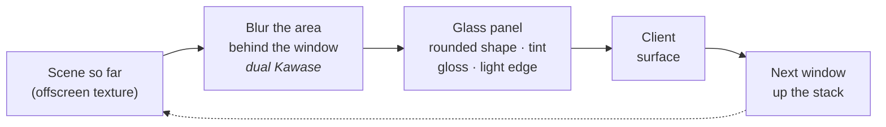
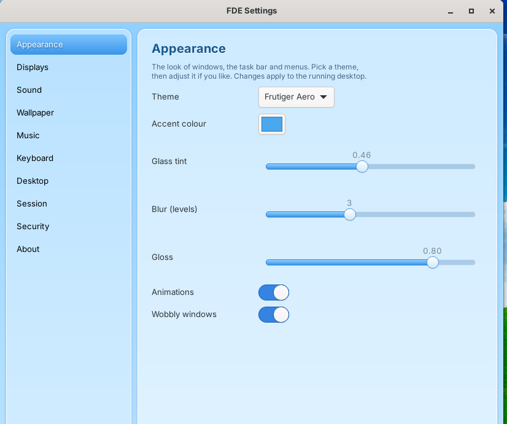
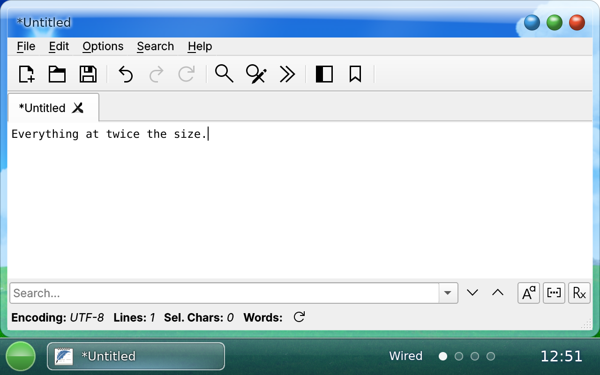

<div align="center">

# FDE · Frutiger Desktop Environment

**A Wayland desktop with real glass.**<br>
Blur, gloss and translucency drawn on the GPU, in the spirit of the Frutiger Aero era.

[](https://github.com/L0rdr-ln/FDE/actions/workflows/build.yml)
[](LICENSE)


[**Try it**](#-try-it) · [**Features**](#-features) · [**Keys**](#%EF%B8%8F-keys) · [**Configure**](#%EF%B8%8F-configuration) · [**Build**](#-build) · [**Roadmap**](docs/ROADMAP.md)


</div>

Glass windows that really blur what is behind them, gloss on the title bars, orb buttons, a
sky-and-hills wallpaper, a glass task bar and start menu. The goal is a **complete desktop
suite** the way GNOME or KDE are (compositor, shell, settings, theme, session), built in stages.

| Start menu <sub>(Windows key)</sub> | Window menu <sub>(right-click a title bar)</sub> | Lock screen | Notifications |
|:---:|:---:|:---:|:---:|
|  |  |  |  |

## ✨ Highlights

- 🪟 **True background blur** behind every glass window, not a fake screenshot trick
- 🎨 **Six built-in themes** from the Frutiger family, plus your own as a small TOML file
- 🫧 **Big animations**: wobbly windows, a genie minimize, glass-shattering close, a workspace cube and Flip 3D Alt+Tab
- 🧰 **A whole shell**: task bar, start menu, notifications, lock and login screens, a GTK4 settings app
- 🖥️ **Multi-monitor and HiDPI**, with a separate scale for each monitor
- 🔒 **Security by default**: ordinary programs can't capture the screen or touch other windows
- 🧪 **Tested without a GPU**: pixel tests on software GL and end-to-end tests with real Wayland clients

## Contents

- [How the glass works](#-how-the-glass-works)
- [Features](#-features)
- [Status](#-status)
- [Try it](#-try-it)
- [Keys](#%EF%B8%8F-keys)
- [Themes and wallpapers](#-themes-and-wallpapers)
- [Configuration](#%EF%B8%8F-configuration)
- [Build](#-build)
- [Project layout](#-project-layout)
- [Documents](#-documents)

## 🔬 How the glass works

FDE is written in Rust on [Smithay](https://github.com/Smithay/smithay), **not** on wlroots.
wlroots' scene graph can only stack pictures and rectangles. It can't read back what is behind
a window, so a true blur isn't possible there.

FDE draws the scene from bottom to top into an offscreen texture. Before each glass window it
does this:



Clients can ask for the same blur behind their own translucent areas with
`ext-background-effect-v1`.

## 🧩 Features

### The desktop programs

| Program | What it is |
|---|---|
| **`fde`** | The compositor: windows, glass frames, effects, input, outputs |
| **`fde-panel`** | Task bar and start menu, one per monitor |
| **`fde-notify`** | `org.freedesktop.Notifications` service with glass bubbles |
| **`fde-lock`** | Lock screen (`Alt+L`), with the password checked by PAM's `unix_chkpwd` |
| **`fde-greeter`** | A greetd login greeter with the same glass card |
| **`fde-shot`** | Screenshots (`Print`) |
| **`fde-settings`** | GTK4 control panel (workspace crate) |
| **`fde-music`** | Optional background music from your own files (workspace crate) |

### Compositor

- **Windows:** xdg-shell windows with server-side glass frames; move, resize, maximize, minimize, fullscreen, snap and tile; popups, focus, keyboard and pointer
- **X11 programs:** XWayland, with the same glass frames
- **Effects** (each one is configurable, and all are plain in fast mode):
  - wobbly windows that bend like springs while you drag them
  - a genie minimize that pours the window into its task bar button, and back out again (`minimize_effect`)
  - a close that shatters the window like glass or switches it off like a television (`close_effect`)
  - new windows that unroll from their title bar (`open_effect`)
  - a desktop that turns like a cube when you switch workspaces (`workspace_effect`)
  - a Flip 3D stack of windows on Alt+Tab (`switcher_effect`)
- **Sharing data:** clipboard and primary selection (middle-click paste) between Wayland and X11 programs; drag and drop, with the dragged picture under the pointer
- **Protocols:** layer-shell with exclusive zones, `ext-background-effect-v1`, `ext-session-lock-v1`, `wlr-foreign-toplevel-management`, wlr-screencopy, fractional scaling, dmabuf, idle inhibit, pointer lock for games
- **Backends:** nested (winit) for development, and DRM/KMS with libseat and libinput for a real console
- **Cursors:** cursors come from your XCursor theme (`appearance.cursor_theme`/`cursor_size`, or `$XCURSOR_THEME`), at the monitor's scale. Clients can ask for named cursors or draw their own

<details>
<summary><b>Task bar and start menu</b></summary>

<br>

- A glass strip in the colour of the window frames, blurred behind
- A start button, and one icon per program covering all its windows: a number shows when there is more than one; click to raise, minimize or cycle through them
- Pinned programs, shown even when they aren't running (right-click a title bar, then **Pin to task bar**)
- CPU and memory load, network, volume, battery, keyboard layout, workspace dots, and the time and date
- **Flyouts:** a volume slider with mute, the Wi-Fi networks, a calendar, and **Alerts** (the notification history, with a quiet-mode switch and **Clear all**)
- Window titles as tooltips
- **Start menu:** the installed applications from `.desktop` files, with a search field (type to filter, Up/Down to move, Enter to start, Esc to clear or close), and a power row with Lock, Log out, Sleep, Restart and Shut down (the last three ask you to confirm)

</details>

<details>
<summary><b>Notifications</b></summary>

<br>

`fde-notify` is the service that `notify-send` and every app talk to over the session bus.
Glass bubbles appear at the top right with the newest on top. They expire on their timeout,
critical ones stay until dismissed, and a click dismisses them. `Alt+N` turns on do not disturb.

</details>

<details>
<summary><b>Settings app</b></summary>

<br>



A GTK4 control panel with the FDE look: accent colour, glass tint, blur, gloss, wallpaper (fill,
fit, stretch, center or tile), keyboard layout and repeat, terminal, task bar, idle lock, night
light and music. Every change is written to `fde.toml` (comments kept, bad values refused) and
the running desktop updates at once.

```sh
sudo apt install libgtk-4-dev
cargo build -p fde-settings
```

</details>

<details>
<summary><b>Multi-monitor and HiDPI</b></summary>

<br>

- Several outputs side by side in one space, each with its own scale (`[outputs.NAME]` in `fde.toml`: scale, mode, position, on/off)
- Windows can sit on or across any monitor; maximize fills the monitor the window is on
- Every monitor gets its own task bar; notifications appear on the first one
- The lock screen covers every monitor
- **Hot-plug:** windows on a monitor you unplug move to the first monitor, and a monitor you plug in is set up at once
- The shell draws at the monitor's scale: whole numbers are drawn exactly, and a 1.5 monitor gets 2x pictures scaled down, so everything stays sharp



</details>

<details>
<summary><b>Night light, music and laptop basics</b></summary>

<br>

- **Night light:** `[display] night_light = true` warms the picture in the evening; screenshots keep their true colours
- **Music:** `fde-music` plays a file or a folder of your own in a loop, with volume and shuffle, and follows the config live. It's off by default and nothing is bundled. `fde-music --check FILE` tells you whether a file will play (building it needs `libasound2-dev`)
- **Laptop keys:** volume, brightness and media keys show a small note. Brightness needs `brightnessctl` or logind
- **Idle:** the screen dims, then goes black (`[session]` in the config)

</details>

<details>
<summary><b>Security</b></summary>

<br>

Ordinary programs can't capture the screen, see or close other windows, or lock the screen.
Only FDE's own programs and named, root-installed ones (grim, the screen-sharing portal, and so
on) can. Only the program that locked the screen can unlock it, and X11 programs can read the
clipboard only while they have the keyboard. See [SECURITY.md](SECURITY.md).

</details>

## 🚦 Status

| | |
|---|---|
| ✅ **Tested** | Everything in [Features](#-features), with software GL and real Wayland/X11 clients, including virtual multi-monitor setups at 2x |
| ⚠️ **Not verified on real hardware** | The DRM/KMS backend (real console and GPU, so multi-monitor output and hot-plug on real GPUs), dmabuf import, sound output, the screen-sharing portal, the polkit prompt, logging in from a display manager. The greeter has only run against a stand-in greetd |
| 🚧 **Not done yet** | GTK/Qt apps asking for blur, touch and tablet input, input methods, turning displays off when idle, drag and drop between X11 and Wayland programs (Smithay has no XDND bridge yet; Wayland↔Wayland and X11↔X11 work) |

See [docs/ROADMAP.md](docs/ROADMAP.md) for the stages and what is next.

> [!TIP]
> If you try FDE on real hardware, please report back, even when it works. Attach the output of
> `fde --check` and `~/fde-last.log`. See [CONTRIBUTING.md](CONTRIBUTING.md).

## 🚀 Try it

### Ready-built

For Ubuntu 24.04+ or Debian 13+ on x86_64. Download the archive from the
[releases](https://github.com/L0rdr-ln/FDE/releases), then:

```sh
tar xzf fde-*-x86_64-linux.tar.gz && cd fde-*-x86_64-linux
sudo ./install.sh --deps && sudo ./install.sh    # then pick "FDE" on the login screen
fde --check                                     # shows what FDE finds on this machine
```

### Nested, from source

FDE runs in a window on your current desktop (X11 or Wayland):

```sh
cargo run &                                                 # opens a window; the task bar starts with it
WAYLAND_DISPLAY=wayland-N cargo run --example demo-client   # N is printed in the log
```

### On a console or in a VM

For Debian or Ubuntu, one script installs everything and builds:

```sh
sudo apt install -y git
git clone https://github.com/L0rdr-ln/FDE fde && fde/tools/vm-setup.sh
~/start-fde            # on a console: Ctrl+Alt+F3, log in, then run it
```

On a console FDE uses the GPU directly (DRM/KMS, libseat, libinput). See
[docs/HARDWARE.md](docs/HARDWARE.md), and [docs/SESSION.md](docs/SESSION.md) for the login screen.

## ⌨️ Keys

> Press **Alt+F1** at any time to see every shortcut on screen.

#### Windows

| Key | Action |
|---|---|
| **Alt+Return** | Terminal (`foot`, or `$FDE_TERMINAL`) |
| **Alt+drag** or drag the title bar | Move; drag the borders to resize |
| **Alt+right-drag** | Resize from the nearest corner |
| Double-click the title bar | Maximize or restore (pull a maximized window down to restore it) |
| Right-click the title bar, **Alt+Space** | Window menu: minimize, maximize, always on top, move to a workspace, close |
| **Alt+f** / **Alt+q** | Maximize / close |
| **Alt+Up** / **Alt+Down** | Maximize / un-maximize, un-snap or minimize |
| **Alt+Left** / **Alt+Right** | Snap to the left or right half (or drag to the screen edge; drag to the top edge to maximize) |
| **Alt+T** | Tile this monitor's windows side by side; press again to put them back |
| **Alt+Tab** / **Shift+Tab** | Window switcher: walk forward or back, release Alt to pick, Esc to cancel |

#### Workspaces

| Key | Action |
|---|---|
| **Alt+1 … Alt+9** | Switch workspace |
| **Alt+Shift+1 … 9** | Send the front window to that workspace |
| **Alt+Ctrl+Left / Right** | Previous / next workspace |
| Three-finger swipe left / right | Next / previous workspace (other gestures go to the program) |

#### Desktop and session

| Key | Action |
|---|---|
| **Windows key** | Start menu |
| **Windows+Space** | Next keyboard layout (with several in `input.keyboard_layout = "us,de"`) |
| **Alt+N** | Do not disturb on/off (the task bar shows "DND") |
| **Print** | Screenshot of the monitor under the pointer, saved to `~/Pictures/Screenshot_DATE.png` |
| Volume, brightness and media keys | Work as on a laptop |
| **Alt+L** | Lock the session |
| **Alt+F1** | Show all shortcuts |
| **Alt+Esc** | Quit FDE |
| **Ctrl+Alt+F1 … F12** | Switch console (DRM backend) |

## 🎨 Themes and wallpapers

Set `appearance.theme` to one of the six members of the Frutiger family:

| Theme | Character |
|---|---|
| **Frutiger Aero** *(default)* | Glossy blue glass, round orbs, a sky and a green hill |
| **Frutiger Aqua** | Water and aquariums: cyan-teal glass and a wallpaper that deepens like the sea |
| **Frutiger Eco** | Fresh green glass, leaf-coloured orbs, a sky fading into grass |
| **Frutiger Metro** | The loud one: saturated green, crisp frames, hot-pink and yellow accents |
| **Dorific** | The warm one: glossy orange glass, amber orbs, cream and sunset gradients |
| **Vector Flourish** | Light and airy: white and pastel glass with soft pink, green and blue orbs |

A theme sets the glass, frame sizes, buttons, wallpaper and the colours of the task bar, menu,
lock screen and notifications. To make your own, see [docs/THEMES.md](docs/THEMES.md).

**Wallpapers:** point `wallpaper.path` at any PNG, JPEG or WebP, or use the Wallpaper page in
settings. To fetch one from the web:

```sh
tools/get-wallpaper.sh URL [fill|fit|stretch|center|tile]   # saves to ~/.local/share/fde/wallpapers/
```

The default wallpaper (`assets/wallpaper.webp`, see [assets/README.md](assets/README.md)) also
appears on the lock screen.

## ⚙️ Configuration

Everything lives in one file, **`~/.config/fde/fde.toml`**. System defaults are in
`/etc/fde/fde.toml`, and your file wins key by key. See
[docs/fde.example.toml](docs/fde.example.toml) for every option.

The file is applied **while FDE runs**: change the accent colour, glass strength, blur,
terminal, keyboard layout or key repeat and the desktop follows within half a second. A file
with an error is reported in the log and ignored. You can edit it by hand or with
[`fde-settings`](#the-desktop-programs).

<details>
<summary><b>Environment overrides</b></summary>

<br>

| Variable | Effect |
|---|---|
| `FDE_TERMINAL` | Terminal for Alt+Return |
| `FDE_LAUNCHER` | Launcher command |
| `FDE_NO_PANEL=1` | Don't start the task bar |
| `FDE_NO_NOTIFY=1` | Don't start the notification service |
| `FDE_AUTOSTART="cmd"` | Run a command at start |
| `FDE_CONFIG=/path/file.toml` | Use only this config file |
| `RUST_LOG=info` | Logging |

</details>

## 🔨 Build

```sh
sudo apt install pkg-config libudev-dev libseat-dev libinput-dev libgbm-dev libegl-dev \
    libgles-dev libxkbcommon-dev libdrm-dev libwayland-dev
cargo build
LIBGL_ALWAYS_SOFTWARE=1 cargo test        # software GL is enough; no display or GPU needed
cargo run -- glass-demo glass-demo.png    # render the demo scene offscreen
```

## 🗂️ Project layout

```
src/            the compositor (fde) and its library
  glass/        the blur and glass shaders
  bin/          fde-panel, fde-notify, fde-lock, fde-greeter, fde-shot
settings/       fde-settings, the GTK4 control panel
music/          fde-music, the background music player
themes/         the six built-in themes (TOML)
assets/         wallpapers and other artwork
tests/          pixel tests and end-to-end tests
tools/          install, packaging and setup scripts
docs/           design notes, guides and screenshots
```

## 📚 Documents

| | |
|---|---|
| [ARCHITECTURE.md](docs/ARCHITECTURE.md) | What is written here and what is reused |
| [ROADMAP.md](docs/ROADMAP.md) | The stages and what is done |
| [HARDWARE.md](docs/HARDWARE.md) | Running from a console, `fde --check`, what to do when it doesn't start |
| [SESSION.md](docs/SESSION.md) | The session and the greetd login screen |
| [THEMES.md](docs/THEMES.md) | Writing your own theme |
| [SETTINGS.md](docs/SETTINGS.md) | The design of the control panel and the config file |
| [CONTRIBUTING.md](CONTRIBUTING.md) | Building, testing, house rules |
| [SECURITY.md](SECURITY.md) | The security model and how to report a problem |

## 🔗 Relation to sfwc

[sfwc](https://github.com/L0rdr-ln/Simple-Floating-Wayland-Compositor) is a small floating
compositor on wlroots. FDE is a separate project with a different goal (looks first). It reuses
ideas from sfwc (the theme format with a `[style]` section, headless pixel tests) but no code.

## 📄 Licence

MIT, see [LICENSE](LICENSE). All artwork must be original or freely licensed.

<div align="center">
<sub>Made with glass, gloss and a little nostalgia.</sub>
</div>
