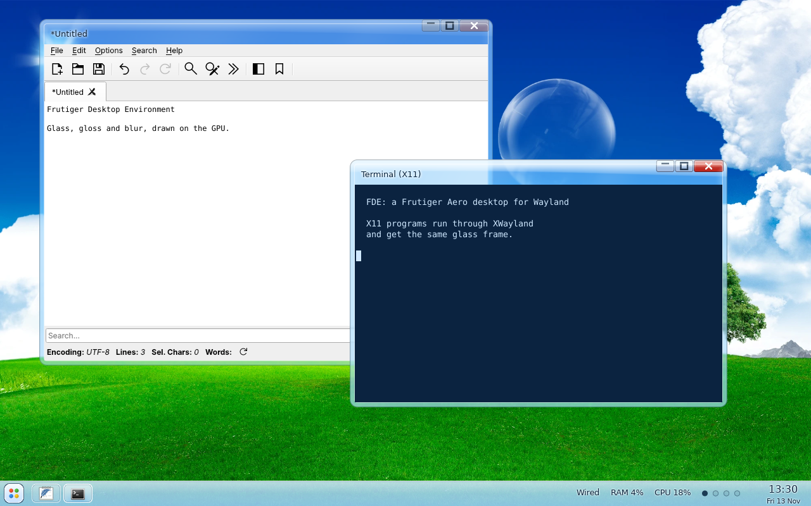
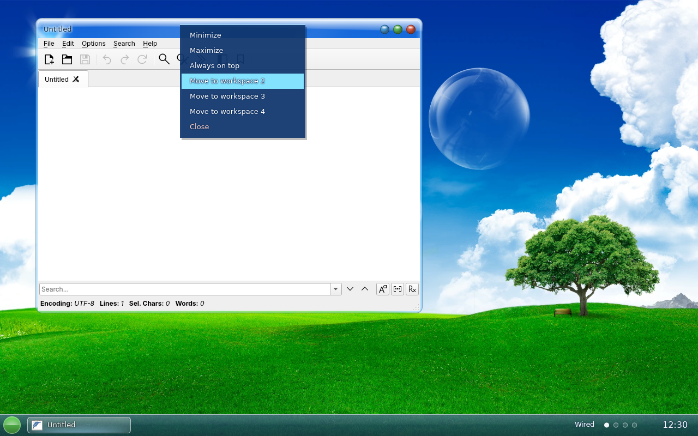
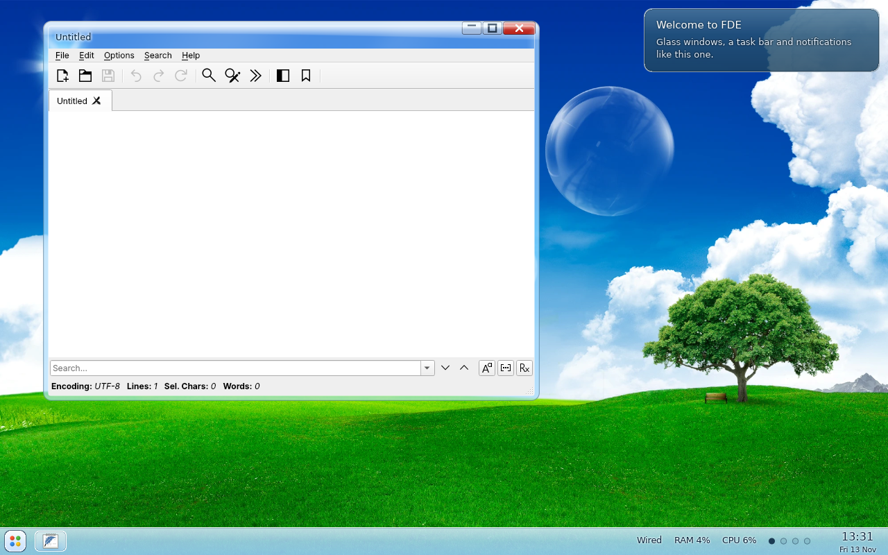

<div align="center">

# Frutiger Desktop Environment

**A Wayland desktop with real glass.**

[](https://github.com/L0rdr-ln/FDE/actions/workflows/build.yml)
[](LICENSE)


[Try it](#try-it) · [Features](#features) · [Keys](#keys) · [Configuration](#configuration) · [Build](#build) · [Roadmap](docs/ROADMAP.md)



</div>

FDE is a desktop in the **Frutiger Aero** style: glass windows that really blur what is behind
them, glossy title bars, orb buttons, and a glass task bar and start menu. The goal is a
complete desktop like GNOME or KDE (compositor, shell, settings, themes, session), built in
stages.

It is written in Rust on [Smithay](https://github.com/Smithay/smithay). Before drawing each
window, FDE blurs what is already drawn behind it, then lays the glass panel and the app on top.
wlroots can't read back what is behind a window, so it can't do this.

| Start menu | Window menu | Lock screen | Notifications |
|:---:|:---:|:---:|:---:|
|  |  |  |  |

## Features

- **Compositor:** glass window frames, snapping, tiling, workspaces, XWayland, multi-monitor with a scale per monitor, layer-shell, screen capture, clipboard, and drag and drop
- **Effects:** wobbly windows, a genie minimize, a glass-shattering close, a workspace cube and Flip 3D Alt+Tab
- **Task bar and start menu** (`fde-panel`): window list, pinned programs, app search, volume, network, battery, calendar and a notification history
- **Notifications** (`fde-notify`), **lock screen** (`fde-lock`), **login screen** (`fde-greeter`) and **screenshots** (`fde-shot`)
- **Settings app** (`fde-settings`): a GTK4 control panel, and the desktop updates as you change things
- **Themes:** Frutiger Aero, Aqua, Eco, Metro, Dorific and Vector Flourish, or your own ([docs/THEMES.md](docs/THEMES.md))
- **Security:** ordinary programs can't capture the screen or touch other windows ([SECURITY.md](SECURITY.md))

**Status:** everything is tested with software GL and real Wayland/X11 clients, but nothing has
run on real hardware yet (the DRM/KMS backend, dmabuf, sound, the login screen). Touch, tablets
and input methods aren't done. See [docs/ROADMAP.md](docs/ROADMAP.md).

## Try it

**Ready-built** (Ubuntu 24.04+, Debian 13+, x86_64): download the archive from the
[releases](https://github.com/L0rdr-ln/FDE/releases), then:

```sh
tar xzf fde-*-x86_64-linux.tar.gz && cd fde-*-x86_64-linux
sudo ./install.sh --deps && sudo ./install.sh    # then pick "FDE" on the login screen
```

**From source**, in a window on your current desktop:

```sh
cargo run
```

**On a console or in a VM** (Debian/Ubuntu):

```sh
git clone https://github.com/L0rdr-ln/FDE fde && fde/tools/vm-setup.sh
~/start-fde
```

If something goes wrong, run `fde --check` and attach its output and `~/fde-last.log` to an
issue. See [docs/HARDWARE.md](docs/HARDWARE.md).

## Keys

| Key | Action |
|---|---|
| **Windows key** | Start menu |
| **Alt+Return** | Terminal |
| **Alt+Tab** | Switch windows |
| **Alt+drag** | Move a window |
| **Alt+Left / Right** | Snap to half the screen |
| **Alt+T** | Tile windows |
| **Alt+1 … 9** | Switch workspace |
| **Alt+q** | Close window |
| **Alt+L** | Lock |
| **Print** | Screenshot |
| **Alt+F1** | Show all shortcuts |
| **Alt+Esc** | Quit FDE |

## Configuration

Everything is in one file, `~/.config/fde/fde.toml`, which you can edit by hand or with
`fde-settings`. Changes apply while FDE runs. See
[docs/fde.example.toml](docs/fde.example.toml) for every option.

## Build

```sh
sudo apt install pkg-config libudev-dev libseat-dev libinput-dev libgbm-dev libegl-dev \
    libgles-dev libxkbcommon-dev libdrm-dev libwayland-dev
cargo build
LIBGL_ALWAYS_SOFTWARE=1 cargo test    # no display or GPU needed
```

For the settings app, also install `libgtk-4-dev` and run `cargo build -p fde-settings`.

## Documents

- [ARCHITECTURE.md](docs/ARCHITECTURE.md): how FDE is built
- [ROADMAP.md](docs/ROADMAP.md): what is done and what is next
- [HARDWARE.md](docs/HARDWARE.md): running from a console
- [THEMES.md](docs/THEMES.md): writing your own theme
- [CONTRIBUTING.md](CONTRIBUTING.md): building, testing, house rules

## Licence

MIT, see [LICENSE](LICENSE). All artwork must be original or freely licensed.
